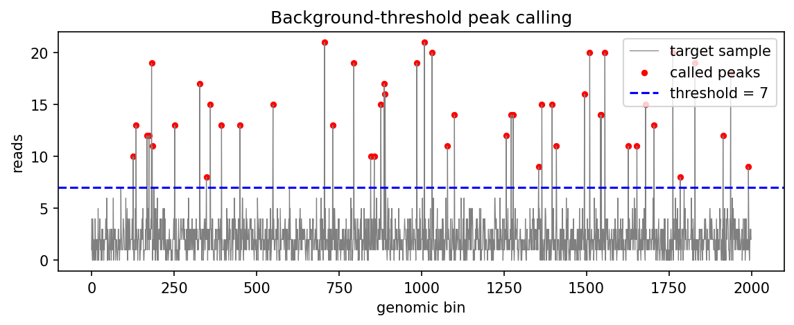

# CUT&Tag Peak Calling Demo

A toy simulation of two core steps in CUT&Tag / CUT&RUN data analysis.

## Part 1: Background-threshold peak calling

- Simulates 2,000 genomic bins with 50 true binding sites (Poisson counts: mean 2 for background, 15 at binding sites).
- Simulates an **IgG control** containing background only.
- Sets the threshold at the 99.9th percentile of the control, a simplified version of the idea behind [SEACR](https://doi.org/10.1186/s13072-019-0287-4) (the real tool works on blocks of signal, not single bins).
- Reports precision and recall against the known true sites.

## Part 2: Depth normalization

- Simulates two samples with identical biology, one sequenced 3× deeper.
- Shows that raw counts differ ~3×, while **CPM** (counts per million) makes them comparable.
- Computes **FRiP** (fraction of reads in peaks) as a quality metric.

## How to run

```bash
pip install -r requirements.txt
python peak_calling.py
```

## Results

```
Part 1: peak calling
  threshold = 7.0 reads
  called peaks = 48, true positives = 47, false positives = 1, missed = 3
  precision = 0.98, recall = 0.94
Part 2: normalization
  raw totals: A = 4630, B = 14099
  mean raw count in peaks: A = 15.4, B = 45.5
  mean CPM in peaks:       A = 3330, B = 3226
  FRiP: A = 0.17, B = 0.16
```


